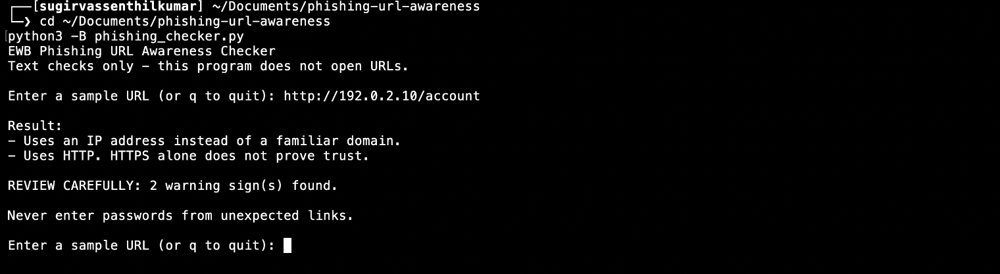
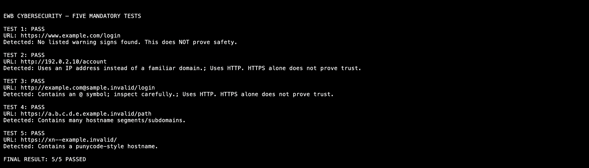

# Phishing URL Awareness Checker

A Python-based cybersecurity mini project developed for the EWB Cybersecurity Internship.

This command-line application examines URL text for common phishing warning signs. It helps users understand suspicious URL patterns without visiting websites or making network requests.

## Features

The checker identifies six warning signs:

| Check | Description |
|---|---|
| @ Symbol | Detects potentially misleading user-information syntax |
| URL Length | Flags URLs longer than 100 characters |
| IP Hostname | Detects IPv4-style numeric hostnames |
| Multiple Subdomains | Flags hostnames containing five or more segments |
| Punycode | Detects the `xn--` marker in hostnames |
| HTTP | Flags unencrypted HTTP schemes |

These indicators are not definitive evidence of phishing.

## Requirements

- Python 3.10 or later
- macOS, Linux or Windows
- No third-party packages
- No API keys or internet connection required for analysis

## Installation

Clone the repository:

```bash
git clone https://github.com/SUGIRVASS/phishing-url-awareness.git
cd phishing-url-awareness
```

Alternatively, download the repository and open its folder in a terminal.

## How to Run

macOS / Linux:

```bash
python3 phishing_checker.py
```

Windows:

```powershell
python phishing_checker.py
```

Enter a sample URL when prompted. Type `q`, `quit` or `exit` to close the program.

## Example Output

Input:

```text
http://192.0.2.10/account
```

Output:

```text
Result:
- Uses an IP address instead of a familiar domain.
- Uses HTTP. HTTPS alone does not prove trust.

REVIEW CAREFULLY: 2 warning sign(s) found.
```

## How It Works

1. Reads the URL as plain text.
2. Removes surrounding whitespace.
3. Parses the URL to identify its hostname and scheme.
4. Checks the six defined warning indicators.
5. Displays the findings and a cautious warning summary.
6. Accepts another URL until the user exits.

A missing scheme is provisionally treated as HTTP for parsing.

## Testing

Five mandatory sample URLs were tested against expected results.

| Test | Sample | Expected / Observed | Status |
|---|---|---|---|
| 1 | `https://www.example.com/login` | No listed warnings | PASS |
| 2 | `http://192.0.2.10/account` | IP hostname and HTTP | PASS |
| 3 | `http://example.com@sample.invalid/login` | @ symbol and HTTP | PASS |
| 4 | `https://a.b.c.d.e.example.invalid/path` | Multiple hostname segments | PASS |
| 5 | `https://xn--example.invalid/` | Punycode marker | PASS |

**Result: 5/5 mandatory tests passed.**

Detailed observed results are available in [tests/test_samples.md](tests/test_samples.md).

## Screenshots

### Program Execution



### Mandatory Test Results



## Improvements

### 1. Continuous URL Checking

Added a loop that allows multiple URL strings to be inspected without restarting the application. Exit commands terminate the program cleanly.

### 2. Warning Summary

Added an explicit review message displaying the number of detected warning signs. Informational messages are excluded from the warning count.

### 3. Malformed Input Handling

Added exception handling for malformed URL formats. Instead of crashing, the application displays an understandable error message.

These improvements were checked using the sample tests and additional malformed-input and exit-command checks.

## Limitations

- This tool performs static, text-based analysis only.
- It never opens URLs or contacts remote servers.
- It does not detect malware or query threat intelligence services.
- Legitimate URLs may contain flagged patterns.
- Phishing URLs may contain none of the six indicators.
- HTTPS does not establish that a website is trustworthy.
- No detected warnings does not mean a URL is safe.

The tool is intended for cybersecurity education, not definitive malicious-URL classification.

## Ethical Use

This project uses fictional sample domains and reserved documentation IP addresses.

It must not be used to collect credentials, deceive users, probe websites or conduct unauthorised security testing.

## Project Structure

```text
phishing-url-awareness/
├── phishing_checker.py
├── README.md
├── requirements.txt
├── tests/
│   └── test_samples.md
└── screenshots/
    ├── sample_run.png
    └── test_results.png
```

## Author

**SUGIRVAS SENTHILKUMAR**

EWB Cybersecurity Internship — Mini Project

## Acknowledgement

Developed following the EWB Phishing URL Awareness Checker workbook, with additional improvements and testing.
